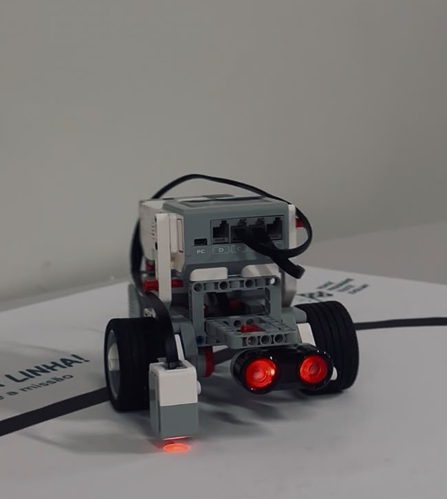
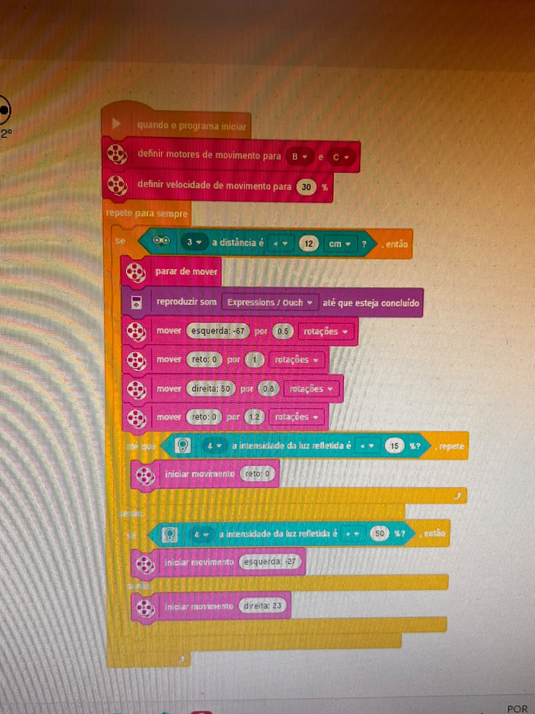

# Projeto II — Robô Patrulha com Desvio de Obstáculos | Patrol Robot with Obstacle Avoidance

Projeto acadêmico desenvolvido para a oficina de **Programação e Robótica LEGO MINDSTORMS EV3 (STEAM)**. O objetivo foi projetar e programar um robô autônomo capaz de seguir uma linha, identificar obstáculos, realizar manobras de desvio e retornar à pista.

An academic project developed for the **LEGO MINDSTORMS EV3 Programming and Robotics Workshop (STEAM)**. The goal was to design and program an autonomous robot capable of following a line, detecting obstacles, avoiding them, and returning to the track.

## Demonstração | Demo

Clique na imagem para assistir à execução do robô.

Click the image to watch the robot in action.

[ Assistir ao vídeo completo | Watch the full video](./assets/execucao.mp4)

## Trabalho em Equipe | Teamwork

Projeto acadêmico desenvolvido em grupo. Esta documentação apresenta a solução construída coletivamente, os componentes utilizados e os resultados dos testes; não se trata de um projeto individual.

An academic team project. This documentation presents the solution developed collaboratively, the components used, and the test results; it is not an individual project.

### Equipe | Team

**Legião do Mal**

- Julia
- Igor Gustavo
- Gustavo
- Juan
- Vitor Emanuel

**Data de conclusão | Completion date:** 18/09/2026

## Desafio e Critérios de Sucesso | Challenge and Success Criteria

O robô deveria cumprir o seguinte ciclo de funcionamento de forma autônoma:

The robot was expected to complete the following operating cycle autonomously:

1. Seguir a linha preta utilizando o sensor de cor.
 Follow the black line using the color sensor.
2. Detectar um obstáculo no percurso utilizando o sensor ultrassônico.
 Detect an obstacle on the track using the ultrasonic sensor.
3. Parar e desviar do objeto por meio de manobras controladas pelas rotações dos motores.
 Stop and avoid the object through maneuvers controlled by motor rotations.
4. Reconectar à linha preta e retomar o percurso.
 Reconnect with the black line and resume the route.

## Hardware e Componentes | Hardware and Components

- **Bloco programável | Programmable brick:** LEGO MINDSTORMS EV3.
- **Atuadores | Actuators:** dois motores EV3 nas portas B e C para tração e direção diferencial.
- **Sensores | Sensors:**
 - **Sensor ultrassônico | Ultrasonic sensor:** detecção de obstáculos à distância.
 - **Sensor de cor | Color sensor:** leitura da intensidade da luz refletida para rastrear a linha preta.
- **Estrutura | Structure:** peças e chassis LEGO Technic, incluindo vigas, eixos, conectores e rodas de borracha.

## Lógica de Funcionamento e Programação | Operating Logic and Programming

O programa foi estruturado em um ambiente de blocos visuais, utilizando uma lógica de execução contínua (`repete para sempre`) combinada com condicionais (`se / então`).

The program was built in a visual block-based environment, using a continuous execution loop (`repeat forever`) combined with conditional statements (`if / then`).

### Monitoramento | Monitoring

O robô realiza leituras contínuas da intensidade da luz refletida, para acompanhar a linha, e da distância frontal, para identificar obstáculos.

The robot continuously reads reflected light intensity to track the line and frontal distance to detect obstacles.

### Detecção de Obstáculos | Obstacle Detection

Quando o sensor ultrassônico identifica uma distância crítica, o robô interrompe a movimentação e emite um alerta sonoro (`Expressions / Ouch`).

When the ultrasonic sensor detects a critical distance, the robot stops moving and plays an alert sound (`Expressions / Ouch`).

### Manobra de Desvio | Avoidance Maneuver

O robô executa uma sequência de deslocamentos direcionais baseada em rotações predefinidas dos motores, realizando o contorno do obstáculo.

The robot executes a sequence of directional movements based on predefined motor rotations to go around the obstacle.

### Retorno à Pista | Returning to the Track

Após a manobra, o sensor de cor procura novamente a linha preta por meio do limiar de reflexão luminosa descrito na programação (`<= 15%`), permitindo retomar o ciclo de patrulha.

After the maneuver, the color sensor searches for the black line again using the reflected-light threshold described in the program (`<= 15%`), allowing the patrol cycle to resume.

## Abordagem STEAM Integrada | STEAM Approach

- **S — Ciências | Science:** aplicação de conceitos de reflexão da luz e propagação de ondas ultrassônicas.
- **T — Tecnologia | Technology:** programação baseada em blocos no ecossistema EV3, com controle de motores e leitura de sensores.
- **E — Engenharia | Engineering:** montagem estrutural em LEGO Technic, distribuição de peso e posicionamento dos sensores.
- **A — Artes | Arts:** criatividade no design da montagem e implementação de feedback sonoro.
- **M — Matemática | Mathematics:** aplicação de porcentagens de intensidade luminosa, limiares de distância, controle de velocidade e contagem de rotações dos eixos.

## Registros do Projeto | Project Gallery

### Robô | Robot

### Programa | Program

## Evidências e Resultados | Evidence and Results

**Status da missão | Mission status:** Cumprida com sucesso | Successfully completed.

O projeto demonstrou a integração entre sensores, motores e lógica de programação para realizar o seguimento de linha e o desvio autônomo de obstáculos.

The project demonstrated the integration of sensors, motors, and programming logic to follow a line and autonomously avoid obstacles.

## Aprendizados e Próximos Passos | Lessons Learned and Next Steps

**Principal aprendizado | Main lesson learned**

Compreensão prática de como integrar hardware — sensores e motores — com o fluxo lógico de programação para conferir autonomia a um sistema robótico.

Practical understanding of how to integrate hardware — sensors and motors — with programming logic to make a robotic system autonomous.

**Melhorias futuras | Future improvements**

Otimização da estrutura de programação para tornar a transição entre o seguimento de linha e a rotina de desvio ainda mais fluida e responsiva.

Optimize the program structure to make the transition between line following and obstacle avoidance smoother and more responsive.
